# OpenDAG

**An open, growing dataset of causal diagrams (DAGs) extracted from epidemiology and clinical papers.**

**Live demo: https://opendag.onrender.com** · Demo film: [`demo/renders/opendag-demo.mp4`](demo/renders/opendag-demo.mp4)
(the free server may take up to a minute to wake on the first visit)

Most observational studies never publish their causal assumptions. OpenDAG reads an open-access paper,
reconstructs its DAG (exposure, outcome, what the authors adjusted for), asks a reasoning model what they
probably *missed*, finds evidence for each suggestion, and lets a person review the result before it joins a
public CC BY 4.0 dataset. Every DAG exports to **DAGitty**, the standard DAG tool in epidemiology.

Built for the Nebius × NVIDIA Global AI Hackathon (Best Apps & Agents).

> AI-assisted, not a substitute for expert epidemiological judgement. AI suggestions are always labelled and kept separate from what the paper reported.

## How it works

```mermaid
flowchart LR
    A[DOI / PMCID / PMID] --> B[Europe PMC<br/>resolve + open-access check]
    B -->|CC-licensed only| C[Section extractor<br/>abstract, methods, stats, results]
    C --> D["Nemotron 3 Nano<br/>(MODEL_FAST)<br/>extract DAG as JSON"]
    D --> E[Validate<br/>Pydantic + networkx acyclic]
    E --> F["Nemotron 3 Super<br/>(MODEL_REASON, thinking on)<br/>missing confounders + bias risks"]
    F --> G[Tavily<br/>evidence per suggestion]
    G --> H[Human review<br/>edit, accept/reject, approve]
    H --> I[(SQLite)]
    I --> J[data/opendag.jsonl<br/>data/dags/*.json, *.dagitty]
```



| Step | What happens | Code |
|---|---|---|
| Fetch | Resolves the ID with Europe PMC (falls back to NCBI's ID converter for DOIs). Rejects anything without a Creative Commons/public-domain licence. Pulls only abstract, methods, statistical analysis and results from the JATS XML, trimmed to `MAX_INPUT_CHARS`. | `app/fetch.py` |
| Extract | **Nemotron Nano** returns study design, population, exposure, outcome, nodes (role, adjusted, ≤20-word supporting snippet), edges and the reported effect. JSON mode, with one retry on invalid JSON. | `app/extract.py`, `app/llm.py` |
| Validate | Normalises messy output, merges duplicate nodes, drops edges to unknown nodes and edges that would create cycles, adds missing confounder→exposure/outcome edges. Every fix is recorded. | `app/graph.py`, `app/schemas.py` |
| Critique | **Nemotron Super** (reasoning enabled) proposes up to 5 unadjusted confounders with rationale and edges, up to 5 bias risks with severity, and a plain-English assessment. All marked *AI-suggested*. | `app/critique.py` |
| Verify | **Nemotron Super** checks each suggested confounder against the paper's own text and must quote the sentence that shows an adjustment; code confirms the quote is in the paper, in a sentence with an adjustment word. Confirmed ones move into the DAG as adjusted (extraction can drop items from long footnote lists), and Nano rewrites the assessment to match. | `app/verify.py` |
| Evidence | **Tavily** searches `"<confounder> <exposure> <outcome> confounding"` and attaches the top 3 sources. Cached. | `app/evidence.py` |
| Screen | Flags unadjusted common causes of exposure and outcome (open backdoor paths). | `app/graph.py` |
| Review | Edit nodes/edges, toggle adjustment, accept/reject each suggestion, approve. Approved records are locked. | `static/app.js`, `app/pipeline.py` |
| Export | DAGitty syntax per DAG; JSONL for the whole dataset. | `app/graph.py`, `app/export.py` |
| Link | Nemotron Nano maps each approved paper's variable names to shared names (true synonyms only), with MeSH terms verified against NLM. Powers the 3D network of all papers. | `app/canonical.py` |
| Insights | Across the dataset: a forest plot of every paper's effect estimate, and which confounders the critique model flags most often (synonyms grouped). | `app/export.py`, `static/app.js` |

## Why Nemotron on Nebius Token Factory

All LLM calls go through **Nebius Token Factory**'s OpenAI-compatible API using the `openai` SDK (`app/llm.py`).
The two steps need different things, so they use different NVIDIA Nemotron models:

- **Extraction → Nemotron 3 Nano (`MODEL_FAST`).** Reading a methods section and listing covariates is
  structured information extraction over a long input. Nano is fast and cheap, handles the long context,
  and follows the JSON schema well. Thinking is switched off (`enable_thinking: false`) to save tokens.
- **Critique → Nemotron 3 Super (`MODEL_REASON`).** Spotting what's *missing*, such as confounding by
  indication or immortal time bias, takes causal reasoning and domain knowledge. The input is small (the
  extracted DAG plus the abstract), so we can afford the larger model with thinking switched on.

This split keeps costs low: the large model never sees the full paper text.

**Why Super and not Ultra?** We tried the model sizes on the critique step. Super reliably catches the
issues an epidemiologist would raise (immortal time bias, confounding by indication, over-adjustment) at a
fraction of Ultra's cost. That matters because the public demo is paid per token and stays open until
judging ends. Ultra is one environment variable away (`MODEL_REASON=nvidia/Nemotron-3-Ultra-550b-a55b`)
for anyone running their own instance.

A typical paper uses about 4,000 input + 1,000 output tokens on Nano and 1,700 + 1,600 on Super.

**Linking papers → Nemotron 3 Nano.** Papers name the same variable differently ("Age (years)",
"age at baseline", "age group"). When a paper is approved, Nano maps each of its variable names to a
shared name, so the dataset network links studies through the variables they have in common. Exposures and
outcomes stay specific; only true synonyms are merged. Each suggested MeSH term is checked against the
National Library of Medicine's MeSH lookup and dropped if it isn't a real heading. Mappings are stored, so
each name is sent to the model once (`app/canonical.py`, `python -m scripts.canonicalize`).

**Ask the dataset → Nemotron 3 Super + Nano.** A question like "Which papers did not adjust for smoking?"
is first turned into a structured query by Super (it follows "only use conditions in the question" more
reliably than Nano). The server runs that query exactly over the records, and Nano writes the answer from
those exact results, citing each paper. Code does the counting and filtering, not the model: in testing,
Nano answering straight from the records got list questions wrong, while this approach matched the ground
truth. Every answer shows how it was computed ("Filtered 14 papers: did not adjust for [smok, tobacco] → 6
match"). Citations to papers that aren't in the dataset are stripped. Rate-limited per IP and cached
(`app/ask.py`).

## How Token Factory accelerated the build

- **One OpenAI-compatible endpoint for every model.** The app uses the standard `openai` SDK with Token Factory's
  base URL, so there was no inference stack to deploy and no GPU to manage. Swapping a model is one environment
  variable (`MODEL_FAST`, `MODEL_REASON`).
- **Fast model comparisons.** Because switching is a config change, we could test Nano and Super on the same task in
  minutes and pick by evidence: on a real paper, Super found "education" in a 30-item covariate footnote that Nano
  missed, so verification uses Super, while extraction and name-merging stay on Nano.
  `python -m scripts.check_setup` lists the Nemotron models your account can use and test-calls both.
- **Reasoning on demand.** Nemotron 3's `enable_thinking` switch let us keep reasoning off for fast, structured steps
  and on for the critique, on the same API.
- **Token counts in every response** made the spending cap possible: each call's real cost is computed from the
  usage Token Factory returns (there is no spend API).
- **Low cost.** Building and testing the whole project, including the live demo recordings, used about $0.15 of
  Nemotron tokens.

**Nebius services used:** Nebius Token Factory (all model inference). We considered Nebius Serverless Endpoints for
hosting (see Deployment) but deployed on Render for the hackathon.

## Why Tavily

The critique model's suggestions are only useful if a reviewer can check them quickly. For every
AI-suggested confounder, Tavily searches for literature linking it to the exposure and outcome, and the
app shows the top sources next to the suggestion. Results are cached, deduplicated, and the paper under
review is filtered out so it can't be cited as evidence against itself.
Token usage for each step is saved with every record (`usage`).

## Who reviewed each DAG

Every record says who made the accept/reject decisions on its AI-suggested confounders (`review.by`):

- **`human`**: a person reviewed it in the app and approved it. These records are locked.
- **`ai`**: Nemotron Super reviewed it (`python -m scripts.autoreview`), accepting a suggestion only if it is a
  plausible common cause of exposure and outcome, not already adjusted for under another name, and not
  caused by the exposure (a mediator or collider). Each decision carries a one-line reason
  (`critique.missing_confounders[].review_note`). These records are labelled "AI-reviewed" in the app and stay
  editable: when a person changes and approves one, it becomes human-reviewed.

The AI reviewer is a stopgap for when there isn't time to review every paper by hand, not a replacement.
Its decisions are not always consistent between runs (in our testing, the same suggestion was rejected
in one run and accepted in another), which matches the findings of Huntington-Klein & Murray (2024).

## Related work

OpenDAG sits next to several existing tools and studies. As far as we could find, none of them reconstructs
the DAG each *published* study assumed, critiques it, and releases the results as an open, human-reviewed
dataset.

- **DAGitty** ([Textor et al.](https://www.dagitty.net)) is the standard tool for drawing and analysing DAGs
  by hand. OpenDAG complements it: every DAG exports to DAGitty syntax so researchers can compute adjustment
  sets there.
- **DAGForge** ([preprint, 2026](https://www.alphaxiv.org/abs/2607.21859.md)) uses an LLM to assemble a DAG
  for a *new* research question from many papers, with evidence excerpts. OpenDAG asks a different
  question: what did *this* paper assume and adjust for, and what might it have missed?
- **LLM DAG agents** such as a LangChain-based medical DAG generator
  ([medRxiv preprint, 2026](https://www.medrxiv.org/content/10.64898/2026.02.06.26345723v1.full.pdf)) draft
  DAGs from literature for a user's study. They produce a diagram per session, not a reusable dataset.
- **Causaly** ([causaly.com](https://www.causaly.com/ai-platform/knowledge-graph)) is a commercial
  knowledge graph of cause-and-effect claims machine-read from biomedical literature. It captures single
  relations ("X causes Y"), not study designs or adjustment sets, and it is not open.

Two studies shaped the design:

- **Tennant et al. (2021)** ([IJE](https://eprints.whiterose.ac.uk/180527/)) reviewed DAG use in applied
  health research and found reporting varies widely; most papers never publish their causal assumptions.
  That gap is what OpenDAG fills.
- **Huntington-Klein & Murray (2024)** ([arXiv 2412.10635](https://ideas.repec.org/p/arx/papers/2412.10635.html))
  found LLMs mediocre and inconsistent at identifying confounders. That is why OpenDAG labels every AI
  suggestion, attaches literature evidence from Tavily, and requires a person to accept or reject each one
  before a DAG enters the dataset.

## Quick start

```bash
git clone <this repo> && cd openDAG
python3 -m venv .venv && source .venv/bin/activate
pip install -r requirements.txt
cp .env.example .env      # add NEBIUS_API_KEY, TAVILY_API_KEY, model IDs
python -m scripts.check_setup   # lists your Nemotron model IDs and tests both keys
uvicorn app.main:app --reload
# open http://127.0.0.1:8000
```

Try `10.1136/bmjopen-2021-051502` (sepsis survivors and out-of-hospital cardiac arrest, BMJ Open 2021).

### Environment variables

See `.env.example`. Required: `NEBIUS_API_KEY`, `TAVILY_API_KEY`, `MODEL_FAST`, `MODEL_REASON`
(copy exact IDs from the Token Factory console). `NEBIUS_BASE_URL` defaults to
`https://api.tokenfactory.nebius.com/v1/`.

### Tests

```bash
pytest -q              # offline: models and Tavily mocked
pytest -q -m network   # also hits the real Europe PMC API
```

### Seeding the dataset

```bash
# add DOIs / PMCIDs to seed_dois.txt, then:
python -m scripts.seed               # creates drafts; review them in the UI
python -m scripts.export_dataset     # writes data/opendag.jsonl + data/dags/
python -m scripts.refresh_evidence   # re-run only the Tavily step (no model calls)
git add data && git commit -m "Dataset update"
```

On startup, an empty database is filled from `data/opendag.jsonl`, so the dataset in git survives
redeploys on hosts with ephemeral disks.

## Cost and abuse protection

- Nano for extraction; the bigger model only for the short critique prompt.
- Input capped by `MAX_INPUT_CHARS`; `max_tokens` capped on every call.
- Papers are cached by PMCID: re-submitting a paper makes no model calls. Tavily queries are cached too.
- Non-open-access papers are rejected before any model call or rate-limit slot is used.
- Per-IP limit (`RATE_LIMIT_PER_HOUR`, default 5 new papers/hour) and a global `DAILY_CAP` (default 50).
  Send `X-Admin-Token: $ADMIN_TOKEN` to bypass them.
- At most 2 papers are processed at once.

## Spending cap

Every paid call (Nemotron on Token Factory, Tavily) passes through `app/budget.py`:

- **Before the call**, its worst-case cost (all allowed output tokens used) is added to what has been spent;
  if that could pass `BUDGET_USD` (default $100), the call is refused. Users see a clear message, and browsing,
  charts and the network keep working.
- **After the call**, the real cost is recorded from the token counts Token Factory returns with every
  response, priced at the models' list prices. An unknown model ID is priced high, so a typo only makes the cap
  stricter.
- **Tavily spend is read from Tavily itself** (`GET /usage`, pay-as-you-go credits × $0.008, cached 5 min).
  Searches inside the free plan cost nothing; on the free plan Tavily stops at its monthly limit anyway.
- **It fails closed**: if the ledger can't be read, paid calls are refused rather than allowed.
- **Restarts can't reset it**: on hosts whose disk is wiped on restart (Render's free plan), the Nemotron total is
  kept in a free [Upstash](https://upstash.com) Redis database (`UPSTASH_REDIS_REST_URL`,
  `UPSTASH_REDIS_REST_TOKEN`). With `REQUIRE_DURABLE_BUDGET=1` (set in `render.yaml`), the public server keeps
  paid features off until that ledger is configured. Put the same two values in your local `.env` so local
  scripts count towards the same total.
- `GET /api/budget` shows the current spend; `SPENT_BEFORE_LEDGER_USD` counts spend from before the ledger existed.

Token Factory has no spend API we could find, and Nebius budgets only send e-mail alerts (hours late) without
stopping usage, so set one in the Nebius console as a second layer, not instead of this cap.

## Alerts

`app/monitor.py` e-mails the owner (via [Resend](https://resend.com); set `RESEND_API_KEY` and `ALERT_EMAIL`):

- **At once, for serious problems**, each kind at most once per cooldown: 25 / 50 / 80 / 100% of the AI budget
  used; the spending ledger unreachable; Token Factory rejecting the API key or calls failing repeatedly; Tavily's
  quota reached; any unexpected server error (users get a plain "reported" message, never a stack trace).
- **Once a day, only on a real jump**: papers, questions or spend at 3x the 7-day average (with a floor).

Counters and "already sent" markers live in Upstash, so restarts neither lose counts nor repeat e-mails. Checks run on
incoming requests (at most every 10 minutes); a sleeping server has no traffic to report on. For "the site is down"
alerts, which an app can't send about itself, add a free uptime monitor such as UptimeRobot on `/api/health`.

## Deployment

**Docker (anywhere)**

```bash
docker build -t opendag .
docker run -p 8000:8000 --env-file .env -v opendag_data:/data opendag
```

**Render (free tier).** Push to GitHub, then *New → Blueprint* and pick this repo (`render.yaml`).
Set the secret env vars in the dashboard. The free tier's disk is ephemeral, so approved DAGs since the
last deploy are lost on restart; run `scripts/export_dataset.py` and commit regularly, or add a disk.

**Fly.io (persistent volume).**

```bash
fly launch --no-deploy --copy-config
fly volumes create opendag_data --size 1 --region lhr
fly secrets set NEBIUS_API_KEY=... TAVILY_API_KEY=... MODEL_FAST=... MODEL_REASON=...
fly deploy
```

**Nebius Serverless Endpoints (optional).** Build the image, push it to Nebius Container Registry, and
create an endpoint from it on port 8000 with the same environment variables. See the Nebius docs for the
current CLI and console steps.

## Dataset

The Dataset page shows two charts built from approved records (tick "show drafts" to include drafts):
a forest plot of effect estimates across studies, and the confounders most often flagged as missing.
`GET /api/dataset/insights` returns the same data as JSON.

- `data/opendag.jsonl`: one approved record per line.
- `data/dags/<id>.json` and `data/dags/<id>.dagitty`: one file per DAG.
- API: `GET /api/dataset.jsonl`, `GET /api/dataset.dagitty`, `GET /api/records/<id>`.

Record schema (`schema_version` 1.0):

```jsonc
{
  "id": "4f8f9ad048",
  "schema_version": "1.0",
  "status": "approved",
  "created_at": "2026-10-28T17:52:16Z",
  "approved_at": "2026-10-28T17:52:37Z",
  "paper": {"title": "", "authors": "", "year": "", "journal": "", "doi": "", "pmcid": "", "pmid": "", "license": "cc by"},
  "study": {
    "study_design": "cohort | case-control | cross-sectional | RCT | other",
    "population": "",
    "exposure": {"name": "", "definition": ""},
    "outcome": {"name": "", "definition": ""},
    "reported_effect": {"measure": "HR", "value": "1.6", "ci": "1.3-1.9", "adjusted": true}
  },
  "dag": {
    "nodes": [{"id": "age", "label": "Age", "role": "confounder", "adjusted": true,
               "snippet": "≤20 words from the paper", "ai_suggested": false}],
    "edges": [{"source": "age", "target": "sepsis", "ai_suggested": false}]
  },
  "dagitty": "dag { ... }",
  "open_backdoors": ["Frailty"],
  "critique": {
    "label": "AI-suggested",
    "missing_confounders": [{"label": "Frailty", "rationale": "", "edges_to_add": [],
                             "evidence": [{"title": "", "url": ""}], "status": "accepted | rejected"}],
    "bias_risks": [{"type": "selection bias", "explanation": "", "severity": "high"}],
    "overall_assessment": ""
  },
  "models": {"extraction": "nvidia/...", "critique": "nvidia/...", "evidence_search": "tavily", "provider": "Nebius Token Factory"},
  "dataset_license": "CC-BY-4.0"
}
```

Roles: `exposure`, `outcome`, `confounder`, `mediator`, `collider`, `effect_modifier`, `other`.
Nodes with `ai_suggested: true` came from the critique model, not the paper, even after a reviewer accepted them.

## Copyright

- Only papers that Europe PMC lists as open access **with a Creative Commons or public-domain licence**.
  Free-to-read papers without a licence (e.g. many COVID-19 papers) are rejected.
- Full text is processed in memory and never stored. We keep metadata, the DAG and supporting snippets of
  at most 20 words.
- Each record keeps the paper's licence. For CC BY-NC papers, note the licence when reusing snippets.

## Limitations

- The extracted DAG reflects what the authors *wrote*, simplified. Edges between covariates are rarely
  stated, so confounders are drawn as simple common causes.
- AI-suggested confounders and bias risks can be wrong or generic; that's why approval requires a person to
  accept or reject each one.
- The backdoor screen is a simple check, not a full adjustment-set analysis. Use DAGitty for that.
- Anyone using the public demo can review and approve drafts. Approved records are locked.
- Europe PMC's search API is occasionally unavailable; DOI lookups fall back to NCBI.

## Licence

Code: [MIT](LICENSE). Dataset (`data/`): [CC BY 4.0](DATA_LICENSE).
